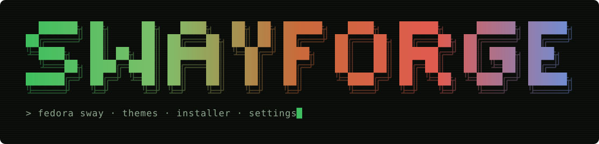
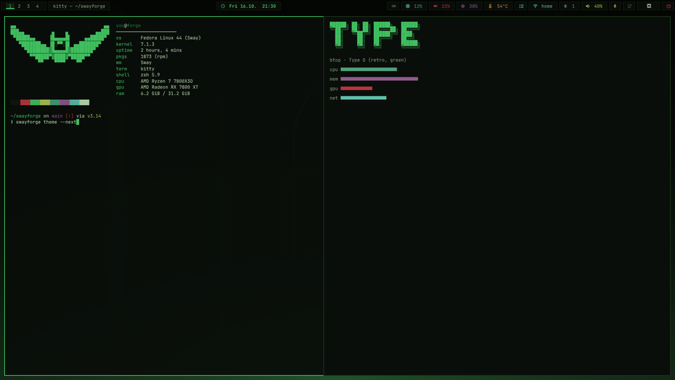
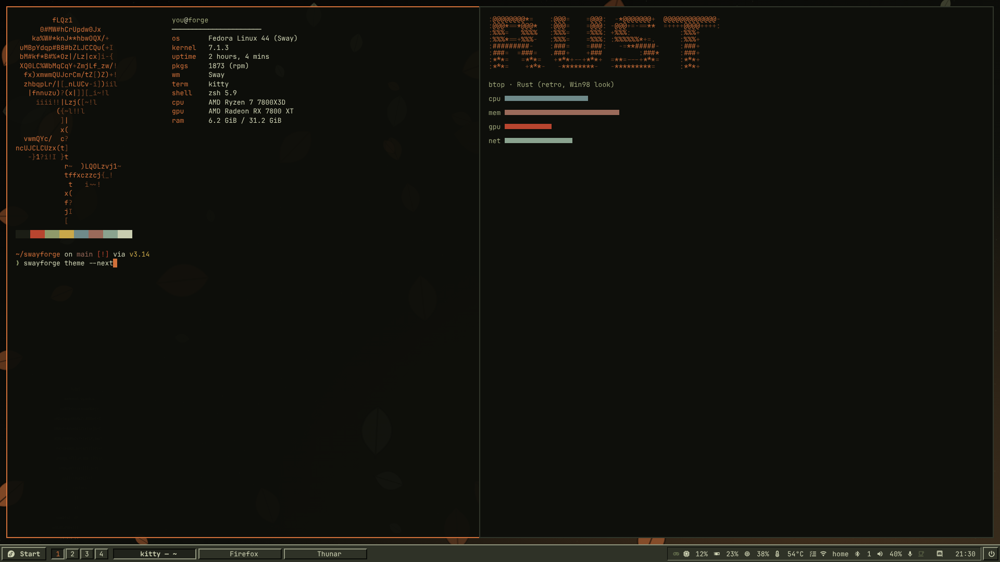
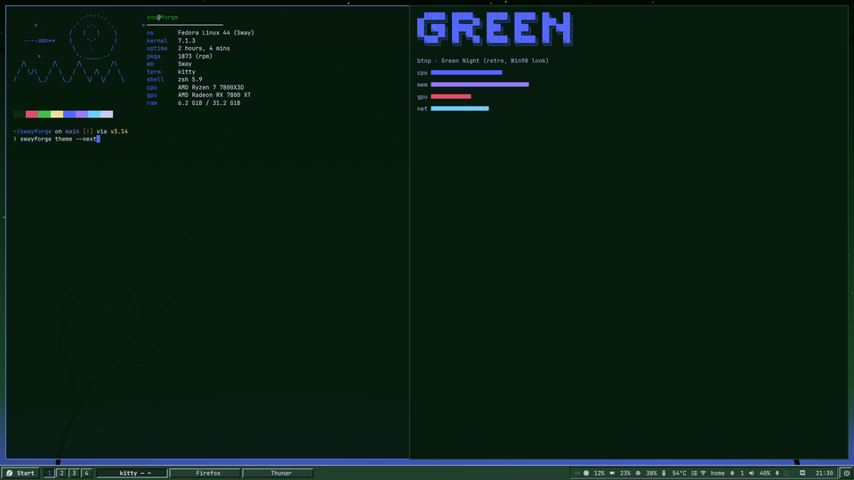
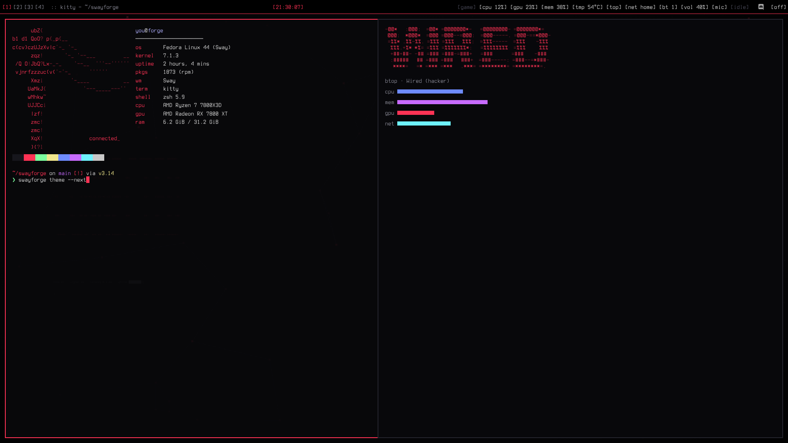
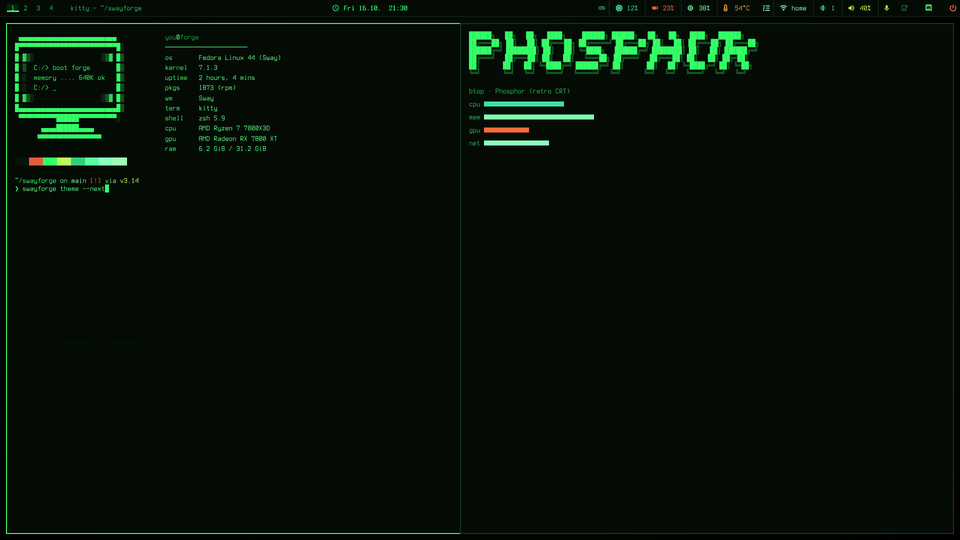
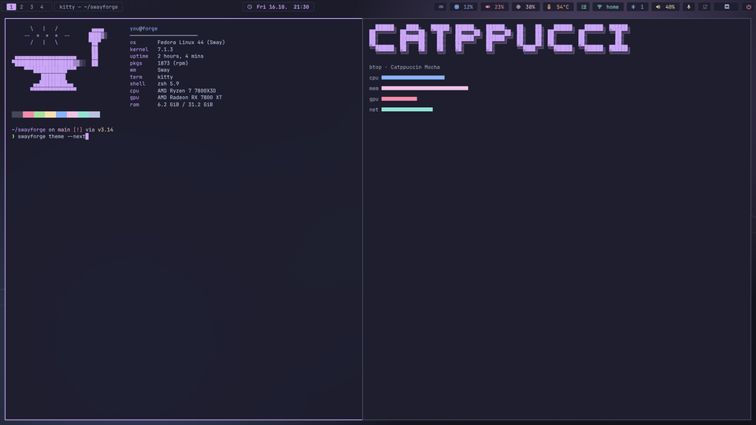
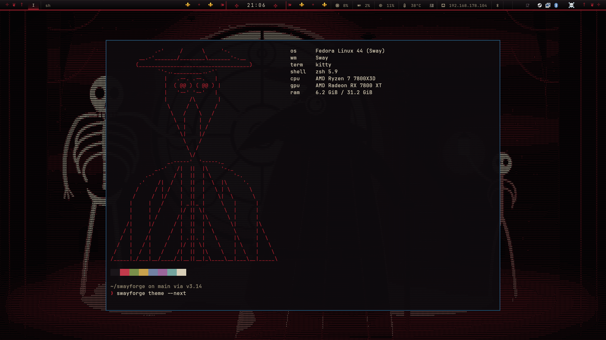
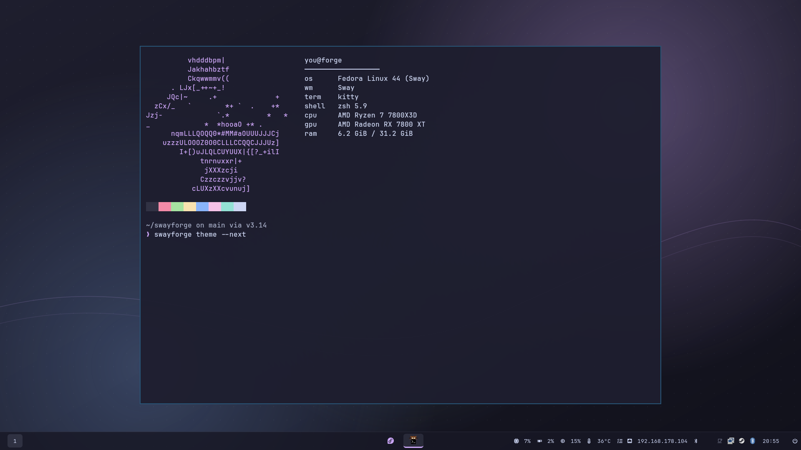
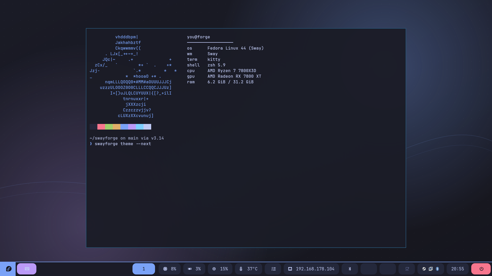

<p align="center">
  
</p>

<p align="center">
  <b>Fedora Sway</b> · AMD · keyboard-first · 17 themes × 10 layouts · 93 apps · reset-friendly
</p>

> ⚠ **Proof of concept, written by Claude (AI) – no warranty, use at your own risk.** See [Disclaimer](#disclaimer).

Set up Fedora Sway in one go – then tweak everything from a terminal app, like KDE's
System Settings but for Sway. Built for the Fedora Sway Spin on AMD graphics, with a focus on
gaming, IT tools, keyboard-driven use and **frequent resets**.

- **Installer** – pick apps, clean-up, theme and layout, run once, reboot.
- **Settings** (`Super+I`) – theme, layout, appearance, bar, displays, audio, system sounds, Bluetooth,
  network, keyboard/mouse, terminal & prompt, shortcuts, power, boot & login, security,
  installed apps, cleanup & drive wiping, files.
- **System sounds** – generated sound packs (gothic church bells, classic bleeps, glass chimes …),
  off by default.
- **Tiling only** by default – no floating windows, no tabs or stacking; workspaces do the rest.
- **17 colour themes × 10 layouts** (incl. *Modern 11* and a *Touch* layout with on-screen keyboard) – every theme recolours Sway, Waybar, Rofi, kitty/Alacritty,
  Spaceship, fastfetch, GTK apps, mako, swaylock, btop, cava, MangoHud, the boot screen and the
  login screen. One Nerd Font everywhere.
- **Your tweaks always win** – every generated file has a companion file that belongs to you.

> New here after a while? Read **[docs/CUSTOMIZING.md](docs/CUSTOMIZING.md)** – it's the
> "how do I change X again?" cheat sheet.

## Screenshots

<table>
  <tr>
    <td><br><sub><b>Type O</b> · Modern islands · bat motif</sub></td>
    <td><br><sub><b>Rust</b> · Classic 98 · rose motif</sub></td>
  </tr>
  <tr>
    <td><br><sub><b>Green Night</b> · Classic 98 · moon motif</sub></td>
    <td><br><sub><b>Wired</b> · Wired layout · network motif</sub></td>
  </tr>
  <tr>
    <td><br><sub><b>Phosphor</b> · Solid bar · CRT motif</sub></td>
    <td><br><sub><b>Catppuccin Mocha</b> · Modern islands · forge motif</sub></td>
  </tr>
  <tr>
    <td><br><sub><b>Requiem</b> · Cathedral · black-death ASCII wallpaper</sub></td>
    <td><br><sub><b>Catppuccin Mocha</b> · Modern 11 · centered taskbar</sub></td>
  </tr>
  <tr>
    <td><br><sub><b>Tokyo Night</b> · Touch · big tap targets + on-screen keyboard</sub></td>
    <td></td>
  </tr>
</table>

<sub>Rendered from the real generated configs (bar, colours, fastfetch art, fonts).</sub>

---

## Install (after every reset)

1. Install the **Fedora Sway Spin**, log in, open a terminal (`Super+Enter`).
2. Get this repo onto the machine:
   ```sh
   git clone https://github.com/Diesumpfeule/swayforge.git && cd swayforge
   ```
3. Run it:
   ```sh
   ./install.sh
   ```

The installer asks for your sudo password once and walks you through
**Apps → Clean-up → Look → Summary → Install**. Reboot when it's done.

### The fast way from the second time on

**Updating:** *Settings → About & updates* shows the installed version of swayforge and wolfforge
and whether GitHub has a newer one. *Update from GitHub* pulls both, installs them and applies
your settings again. Your settings, themes and tweaks stay. On the command line:
`swayforge version` / `swayforge update`. When everything worked, the update terminal closes by itself
and the settings app restarts in its own window with the new version. If a step fails, the terminal
stays open so you can read why.

**Crashes:** if swayforge, the installer, wolfforge or one of their helpers crashes, you get a
notification and a report in `~/.local/share/swayforge/crashes/`. A terminal app keeps its window
open with the error until you press Enter. *About & updates* lists recent reports.

`Super+I → System & files → Export` saves settings, app selection, your themes, ASCII art,
tweaks and the CS2 translator into one file. After the next reset:

```sh
./install.sh --restore ~/swayforge-backup.tar.gz   # everything back, no questions
./install.sh --yes                                 # just the saved profile, no questions
./install.sh --dry-run                             # only show what would happen
```

Tip: commit your exported backup (or `~/.config/swayforge/`) to a private repo too.

## What you can install

**Bold** = ticked by default · \* = Flatpak (only when there's no maintained RPM).
Everything is optional except the Sway base.

| Group | Apps |
|---|---|
| Desktop | **Sway base**, **Thunar file manager**, **Image & video viewers**, **Terminal tools**, **cava**, SwayFX (effects) |
| Gaming | **Steam**, **GameMode + MangoHud**, **Protontricks**, **ProtonPlus**, **Prism Launcher**, **Heroic Games Launcher**, **Discord**, Vesktop*, Lutris, Bottles, Gamescope, CoreCtrl, RetroArch, ProtonUp-Qt*, Dolphin, PCSX2*, Ruffle*, OpenRGB |
| Browser | **Firefox**, Brave, **LibreWolf**, **[wolfforge](https://github.com/Diesumpfeule/wolfforge)** (LibreWolf overhaul), Chromium, Zen Browser* |
| Dev | **Visual Studio Code**, VSCodium, **Python**, **uv**, Thonny, **Compilers & build tools**, **Podman**, **GitHub CLI + tig**, Node.js, Rust, **tmux**, **Distrobox** |
| IT & Security | **Network tools**, **Wireshark**, **Virtual machines (KVM)**, Tailscale, Remmina, Password audit tools, **KeePassXC**, **Malware & rootkit scanners**, USBGuard, Pentest basics, Kali container, Ghidra*, WireGuard tools |
| Media | OBS Studio, **VLC**, Kdenlive, Audacity, EasyEffects, LibreOffice, GIMP, Inkscape, Krita, Blender, Spotify*, Obsidian*, Thunderbird, qBittorrent, **yt-dlp**, Syncthing, **7-Zip + unrar** |
| USB & SD | **balenaEtcher**, **Raspberry Pi Imager**, Fedora Media Writer, **GParted** |
| Maker | FreeCAD, KiCad, PrusaSlicer |
| System | RPM Fusion, codecs, AMD video acceleration, firmware updates, Timeshift, Bluetooth, Flathub |
| Boot & login | themed Plymouth boot screen, tuigreet login |
| Own tools | [CS2 chat translator](https://github.com/Diesumpfeule/cs2translate) |

**LibreWolf follows your theme:** with [wolfforge](https://github.com/Diesumpfeule/wolfforge) installed,
every theme change also re-themes LibreWolf (toolbar, tabs, start page, new tab) – swayforge writes
`~/.local/share/swayforge/generated/palette.json`, wolfforge picks it up.

Missing something? Add it to `~/.config/swayforge/catalog.toml` – see
[docs/CUSTOMIZING.md](docs/CUSTOMIZING.md#recipes).

## Packages: Fedora first

1. **Fedora repos** whenever possible
2. **RPM Fusion / COPR / vendor RPM repos** – Steam & Discord (RPM Fusion), Prism Launcher &
   ProtonPlus (COPR), Heroic & balenaEtcher (official RPMs from GitHub), Brave / LibreWolf / VS Code / VSCodium (vendor repos)
3. **Flatpak** only when there's no maintained RPM (Spotify, Obsidian, Zen, Vesktop, PCSX2, Ruffle, Ghidra …) – marked **[Flatpak]**

swayforge also switches dnf to **Enter = yes** (`[Y/n]` instead of `[y/N]`). That applies to
`dnf remove` too – read before pressing Enter.

## Themes

| Theme | Style |
|---|---|
| Catppuccin Mocha / Latte, Dracula, Everforest, Gruvbox, Nord, Rosé Pine, Tokyo Night | classics |
| **Clean** | neutral base for building your own |
| **Rust** | black, sage green, rust orange · Classic 98 layout · autumn-leaves wallpaper |
| **Green Night** | deep green, blue, moon-white · Classic 98 layout · moonlit night wallpaper |
| **Type O** | gothic black & deep green · pointed-arch wallpaper |
| **Phosphor** / **Amber** | green / amber CRT · Terminus font · BIOS wallpaper |
| **Wired** | full-on hacker: black, red, static, network nodes · Wired layout |
| **Onyx** | pure black & white, square, no colour at all |
| **Requiem** | gothic cathedral: black, bone white, crimson, a touch of deep green · Cathedral layout · rose-window wallpaper with stained glass, lancet windows, candles and a wrought-iron fence |

Retro themes bring their own style (square corners, retro font, layout). Switch to another theme
and your own values come back. **Make your own:** `Theme → Edit colours → Save as my theme`.

**Wallpapers:** drop images into `~/Pictures/Wallpapers` (*Theme → Open wallpaper folder*, drag
them in, press ↻) and pick one from the list. A localized Pictures folder (e.g. `~/Bilder`) works too.
The theme motifs swayforge draws itself are saved there as `swayforge-<theme>.png` – pick, copy or delete them like any other wallpaper.

**Theme from wallpaper:** `Theme → Wallpaper → Theme from wallpaper` (or
`swayforge theme --from-wallpaper IMAGE`) sets the image as wallpaper and builds a whole theme from
its colours. Background and text take the picture's main hue but stay calm, the accents are its
most striking colours, and every text colour is checked for contrast. Dark or light follows the
picture, or you force one. Your bar, terminal, Rofi, GTK apps and LibreWolf all follow. Each new
picture replaces the last "From wallpaper" theme. To keep one, name it and press *Save as my
theme*, or use `--save "NAME"` on the command line.

## Layouts

| Layout | Look |
|---|---|
| Modern islands | floating rounded islands at the top |
| Solid bar | one continuous bar at the top |
| **Classic 98** | bottom taskbar, Start button, 3D bevelled buttons, sunken tray (GTK apps too) |
| **Glass 7** | bottom glass taskbar, round start orb, icon-only task buttons |
| **Wired** | text only, `[brackets]`, no icons, seconds ticking, terminal-style launcher |
| Minimal | only workspaces, clock, tray, power |
| Sidebar | vertical icon bar on the left |
| Cathedral | gothic: stone bar with a crimson double rule, roman-numeral workspaces, ✠ around the clock, framed launcher and notifications |

Any layout works with any theme. `Super+Shift+B` cycles bar layouts, `Super+Shift+T` cycles themes.

## ASCII art

Classic shaded ASCII art: each motif is drawn from simple shapes, lit from the top left and
turned into characters from a density ramp – dense letters for lit surfaces, dots and commas for
shadows. Banners (installer, settings, boot screen, power menu, start page) use shaded capitals.
Everywhere it appears, dense characters take the accent colour and light ones a darker shade.

```
@@@@@@-  :*@@@@@= @@@@@@+   :+@@@@@* @@@@@@-
@@=...  .@@=   @@ @@= -@@  .@@=    : @@=...
%%%%%%: -%%    =% %%%*%%-  -%%  -*** %%%%%%:
##=     .##=   ## ##=:+##  .##=   ## ##=
**=      :******= **=  +**  :+****** ******+
```

```
      '
                wUvxkr        .
  o#adqmwqQ     hkdYu)     ZqO0mmOcf
0h*ahdpdkkkbOCY QLdxC/-OqbbdmZmmO0OQu{
 jb*ohbdbhhkpqppokQXu(bpmwmmOmwmmOL|!
 QamUZdpmwqqppb#@8Mbx_cZmO0OQ000Xnc|!
 n]! JkkqmkkwpbaW*awx+(mO0ZLXJJX~ ~-!
     cOr?-UqqdULbbkQ{~[Xm0U[!}f/l
      -   )CL}!|X00j+~!{vU}l   i
           1+   )f[~~!   ]!
   *             ]r[l
                                  +
```

Motifs: `forge` · `anvil` · `bat` · `moon` · `rose` · `skull` · `lantern` · `crt` · `terminal` ·
`gamepad` · `cyberdeck` · `wired` · `rosewindow` – or your own `~/.config/swayforge/ascii/NAME.txt`.
`scripts/make_art.py` regenerates them (needs numpy, scipy, Pillow – only for development).

**Animated:** a glint of light sweeps across the art every few seconds and lone sparks twinkle. You
see it in the settings app, in the installer and in LibreWolf (start page and new tab, via wolfforge).
A new terminal plays a one-second ignite animation before fastfetch draws its logo; any key skips
it. Turn it off under *Theme → Animate the ASCII art*.

The installer opens with a short animation (about 1.5 s): the motif ignites out of sparks, then the
name is forged left to right. Any key skips it; `SWAYFORGE_NO_INTRO=1` turns it off.

## Installed apps, cleanup & drives

- **Settings → Installed apps** – everything installed, grouped like the installer, plus
  **Other** for what you installed yourself (dnf or Flatpak). Shows source (Fedora, RPM Fusion,
  COPR, Flatpak, vendor repo) and size; *Uninstall* opens a terminal where dnf/flatpak ask once more.
  The Sway base can't be removed from here.
- **Settings → Cleanup & drives** – frees space with plain, well-known commands, each with its size:
  package cache, unneeded packages, old logs (keeps 2 weeks), crash dumps, trash, thumbnails,
  unused Flatpak runtimes. Plus ncdu and BleachBit if installed (installer → System → Cleanup tools).
- **Drive wiper** – for USB sticks, SD cards and external SSDs. Only drives that are removable and
  hold nothing of the running system are listed, so internal disks never show up.
  - *Quick*: new partition table and empty file system in seconds.
  - *Secure*: zero-fill every byte, or discard/TRIM all blocks on SSDs and SD cards.
  - Then format as exFAT, FAT32, ext4 or leave it empty.

  You type the device name to confirm. The terminal re-checks the drive (size and removability)
  right before it starts. `swayforge wipe` does the same from the command line. Note that flash
  wear levelling can keep stray old blocks – for secrets, use encryption from the start.

## Mount drives

**Steam downloads GBs before CS2?** That is Steam's *shader pre-caching*, not a lost cache: Valve
republishes the game's pre-cache as one big file (CS2: ~7 GB, no delta), so Steam fetches it again
whenever it changed. The optional add-on **steamtune** (installer → *Own tools*, off by default) explains
it for your system and helps – in **Settings → Games** (limit and move fields per drive) or on the command line (`swayforge steam` / `steamtune`):

- `steamtune` – what Steam downloaded and when, shader cache size per drive
- `steamtune limit 1 30G` – cap the cache on library 1 (Steam has no limit of its own); `steamtune prune`
  drops the cache of the longest-unplayed games until it fits – also done at every login
- `steamtune move 1 /mnt/games/sc` – keep that library's cache on another drive (`... back` undoes it)
- `steamtune window 03-06` – Steam auto-updates only at night

Everything that changes files needs Steam closed; `config.vdf` is backed up first. You can also switch
*Properties → Shader Pre-Caching* off per game in Steam. Dropped caches are fetched again if pre-caching is on.

*Settings → Mount drives* (or `swayforge mount`): pick a partition, internal or external. Give it
a name, press *Mount permanently*, and it shows up at `/mnt/NAME` and in Thunar's sidebar, now and
after every reboot. swayforge adds a line to `/etc/fstab` using the partition's UUID:

- Every entry gets `nofail` and a 5-second timeout, so a missing drive never blocks booting.
- NTFS, exFAT and FAT drives belong to you. A fresh empty Linux drive gets handed to you too.
- `/etc/fstab` is backed up first and checked with `findmnt --verify`. If the check finds a new
  error, the backup goes straight back.
- *Remove* unmounts the drive and deletes only swayforge's line. The data on the drive stays.
- System partitions (`/`, `/boot`, EFI, swap) never show up.

```
swayforge mount                     list: mounted by swayforge / can be added
swayforge mount add nvme1n1p2 games
swayforge mount remove games
```

## Security

*Settings → Security* (or the command line) runs free scanners from the Fedora repos:

| Tool | What it does |
|---|---|
| **ClamAV** | malware scan of Downloads, your home folder, a USB drive or any path – found files go to a quarantine folder (never deleted), signatures update automatically |
| **rkhunter + chkrootkit** | look for rootkits and backdoors |
| **Lynis** | security audit with a hardening score and tips |
| **USBGuard** (optional) | blocks USB devices you haven't allowed – everything plugged in at install time is allowed |
| Overviews | connected USB devices, drives, ports open to the network, autostart entries and cron jobs |

Every run leaves a report (`~/.local/share/swayforge/security/`). Optional **weekly scan** in the
background with a notification. Linux malware is rare – ClamAV mainly catches Windows malware in
downloads and on USB sticks, so you don't pass it on. Rootkit checkers sometimes raise false alarms:
read the report before acting.

## Keys

| Key | Action |
|---|---|
| `Super+Enter` | terminal |
| `Super+R` | app launcher + run (Rofi combi) |
| `Super+W` / `Super+D` | browser / file manager |
| `Super+Q` | close window |
| `Super+F` / `Super+Shift+F` | maximise (bar stays) / real fullscreen (games, video) |
| `Super+H J K L` or arrows / `+Shift` | move focus / move window |
| `Super+1…0` / `+Shift` | workspace / move window to workspace |
| `Super+A` | focus parent container |
| `Super+Shift+C` / `Super+Shift+E` | reload Sway / exit (asks first) |
| `Super+I` | swayforge settings |
| `Super+F1` | show all shortcuts |
| `Ctrl+Shift+Esc` | task manager (btop) – also a bar button |
| `Super+Shift+G` | gaming mode on/off – also a bar button |
| `Super+Shift+A` / `Super+Shift+I` | audio / network settings |
| `Super+Escape` | power menu (also the bar's ⏻ button) |
| `Super+V` | clipboard history |
| `Super+Shift+S` | screenshot area and edit · `Print` = area to clipboard |
| `Super+Shift+T` / `Super+Shift+B` | next theme / next bar layout |

**Tiling only (default):** every window tiles – dialogs too – and there are no floating, tabbed
or stacked layouts; use workspaces instead. `Super+F` maximises the focused window but keeps the bar
(press it again to get the split back). Splits, resize mode, floating, tabs and the scratchpad
are still in *Settings → Shortcuts* without a key – give them one if you want them, or switch
*Appearance → Tiling only* off.

**Bar:** click speaker/Bluetooth/network → matching settings page; right-click = mute/advanced;
scroll = volume. Volume and brightness keys show a themed on-screen display.

**Gaming mode:** no gaps or borders, notifications muted, no auto-lock, power profile
"performance". Toggle again to restore everything.

## Boot & login screens

- **Boot screen (Plymouth):** BIOS/POST, ASCII art, Wired, Classic PC or Minimal – in your theme
  colours, font and ASCII art. `Settings → Boot & login → Install boot screen` (rebuilds the
  initramfs, about a minute). Re-run after changing the theme if you want them to match.
- **Login (tuigreet):** keyboard-only text login with your ASCII art, replaces SDDM.
  Emergency: `Ctrl+Alt+F3`, log in, run `bash ~/.local/share/swayforge/generated/boot/restore-sddm.sh`.

## Command line

```
swayforge                     settings app   (--page audio|network|layout|boot|…)
swayforge install             installer      (--yes, --dry-run, --profile FILE)
swayforge apply               regenerate configs + reload
swayforge theme NAME          switch theme   (--list, --next)
swayforge layout NAME         switch layout  (--list, --next)
swayforge boot / login        install boot screen / login screen
swayforge gamemode            toggle gaming mode
swayforge hello               animated ASCII greeting, then fastfetch
swayforge version / update    installed versions · update both from GitHub
swayforge scan [TARGET]       malware scan: downloads | home | drives | PATH
swayforge audit rootkit|system  rkhunter + chkrootkit / Lynis
swayforge steam [...]         Steam shader-cache helper (optional add-on steamtune)
swayforge wipe [DEVICE]       wipe + format a USB stick / SD card / external SSD (no DEVICE = list)
swayforge import-sway FILE    take over an existing Sway config
swayforge export [FILE]       back up;  swayforge restore FILE
```

Install log: `~/.local/share/swayforge/install.log`

## Repository layout

```
install.sh                 entry point after a reset
docs/CUSTOMIZING.md        how to change things (start here)
extras/cs2/                CS2 chat translator + watcher (auto-starts with CS2)
extras/opencode/           opencode installer + home-server (Ollama) setup script
swayforge/
  data/catalog.toml        everything the installer can install
  data/themes/*.toml       colour themes
  templates/*.j2           config templates (sway, waybar, rofi, kitty, …)
  render.py                turns settings + theme + layout into config files
  layouts.py               bar/UI layouts
  ascii.py                 shaded banner font + ASCII motifs (data/art/)
  apps.py / cleanup.py     installed-apps overview, cleanup, drive wiper
  boot.py                  Plymouth boot screens + tuigreet login
  tui/                     the installer and settings apps (Textual)
scripts/make_art.py        regenerates the ASCII art (dev only)
scripts/make_banner.py     regenerates docs/img/banner.svg
scripts/make_screenshots.py renders README screenshots in a headless Sway (throw-away HOME)
```

## CS2 chat translator

Bundled in `extras/cs2/`. The installer item *Own tools → CS2 chat translator* sets it up: a
watcher started by Sway runs the overlay while CS2 runs, coloured in your theme. Once per reset:
Steam launch option `-condebug`, CS2 display mode *Fullscreen windowed*. Positioning, test run,
options and log: *Settings → Apps & shortcuts*. Details: [extras/cs2/README.md](extras/cs2/README.md).

## Gaming tips

- Steam launch option for performance + FPS overlay: `gamemoderun mangohud %command%`
  (for CS2 add `-condebug` for the chat translator)
  (MangoHud on/off: right Shift+F12).
- Install Proton-GE via **ProtonPlus**, then pick it per game in Steam.
- Turn on FreeSync under Displays; "Allow tearing in games" lowers input lag.

## Credits

The bundled colour themes are based on these palettes – all credit for the colours goes to
their authors: [Catppuccin](https://github.com/catppuccin/catppuccin),
[Dracula](https://draculatheme.com), [Everforest](https://github.com/sainnhe/everforest),
[Gruvbox](https://github.com/morhetz/gruvbox), [Nord](https://www.nordtheme.com),
[Rosé Pine](https://rosepinetheme.com) and
[Tokyo Night](https://github.com/enkia/tokyo-night-vscode-theme).
The retro themes (Type O, Rust, Green Night, Phosphor, Amber, Wired, Clean) and all ASCII art
are original to this project; "Type O" and "Rust" are fan-made tributes and not affiliated with
anyone.

Built on great free software: [Sway](https://swaywm.org), [Waybar](https://github.com/Alexays/Waybar),
[Rofi](https://github.com/davatorium/rofi), [Spaceship](https://spaceship-prompt.sh),
[Nerd Fonts](https://www.nerdfonts.com), [Textual](https://textual.textualize.io) and Fedora.

## Disclaimer

**This is a proof of concept** – not finished, not polished and not tested on every setup.
The code was written by **Claude**, an AI model by Anthropic, following my ideas and
instructions. It is provided **as is, without any warranty**, and I take **no responsibility**
for anything it does to your system, your data or your accounts. Read the scripts before you
run them – use at your own risk.

## Contributions

This is a personal project: pull requests and outside code are not accepted. Feel free to fork it.

## License

MIT – see [LICENSE](LICENSE).
