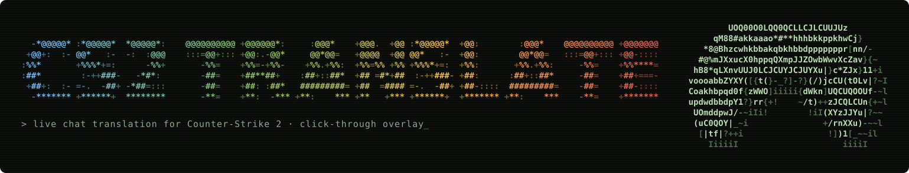

  

# cs2translate – CS2 chat translator

[cs2translate](https://github.com/Diesumpfeule/cs2translate) translates the Counter-Strike 2 chat
live. It only reads `console.log`, which CS2 writes itself with the launch option `-condebug`,
and shows the translation as a click-through overlay over the game chat. A copy is bundled here
so the installer works offline.

## What swayforge does with it

The installer item **Own tools → cs2translate** (on by default):

- installs `python3-tkinter` (for the overlay window)
- copies the program to `~/.local/share/cs2translate/`
- puts a watcher in place that **Sway** starts on login: it waits for `cs2`, starts the
  translator (`--history 0`), stops it when the game closes, and doesn't restart it in a loop
  if it crashes
- replaces an older German install (`cs2-chat-uebersetzer`) and its GNOME-style autostart
- colours the overlay in your **theme** (CT = theme blue, T = theme yellow, all chat = theme
  green, background, text and logo colour) using your Nerd Font – re-done on every theme change

Settings app → **Games** has the options (font size, opacity, how long messages stay, lines, language,
hide original) plus buttons for positioning, a test run and your own options file.

## Once per reset

1. Steam → CS2 → *Properties → Launch options*: `-condebug`
   (together with the gaming tip: `gamemoderun mangohud %command% -condebug`)
2. CS2 → *Video*: display mode **Fullscreen windowed**
3. While CS2 runs: `cs2translate --move` – drag the overlay over the chat, `Esc`

The overlay position is saved in `~/.config/cs2translate.json` and goes into the swayforge
export, so after `./install.sh --restore` you only need step 1.

## Files

| File | What |
|---|---|
| `cs2translate.py` | the program (same as in the cs2translate repo) |
| `install.sh` | used by the swayforge installer |
| `watcher.sh` | becomes `~/.local/bin/swayforge-cs2-watcher` |
| `uninstall.sh` | removes everything again (also copied next to the installed program) |

| Path on the system | What |
|---|---|
| `~/.config/swayforge/cs2.args` | options for auto-start and `cs2translate`, e.g. `--font-size 14 --no-original` |
| `~/.config/cs2translate.json` | overlay position + theme colours (the `"theme"` key is rewritten by swayforge) |
| `~/.cache/cs2translate.log` | log – first place to look if nothing shows up |

To keep your own overlay colours, put `"theme_locked": true` into `~/.config/cs2translate.json` –
swayforge then leaves the `"theme"` key alone.

## Notes

- CS2 runs through XWayland. The overlay is an X11 override-redirect window, which Sway draws
  above fullscreen XWayland games, and clicks pass through to the game.
- `--window` (normal window mode) opens floating and sticky.
- Translation uses Google's unofficial `translate_a` endpoint with MyMemory as fallback. Neither is
  an official API for third-party tools – they can block or change at any time.
